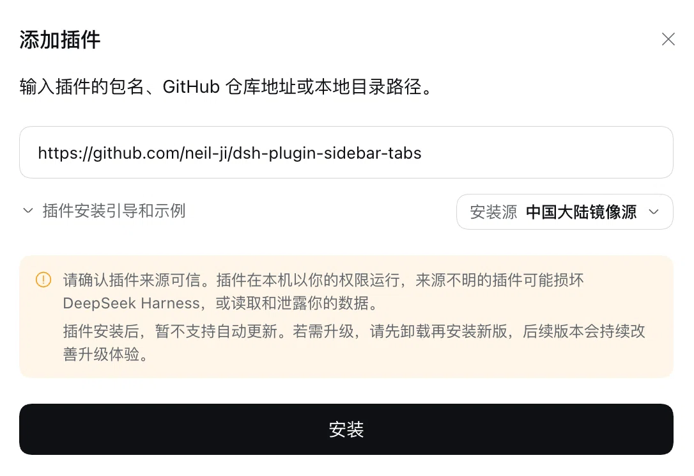
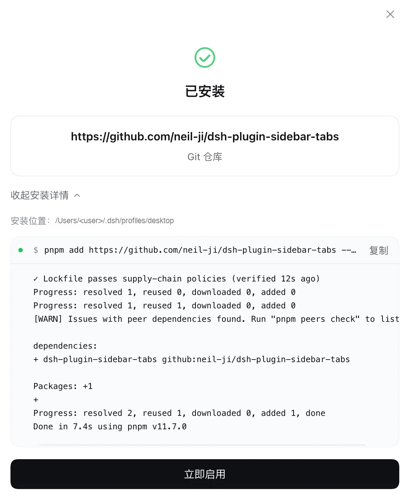
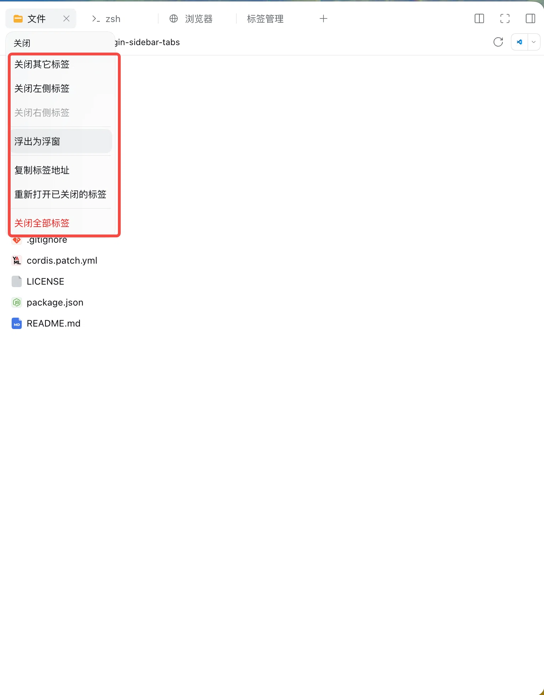
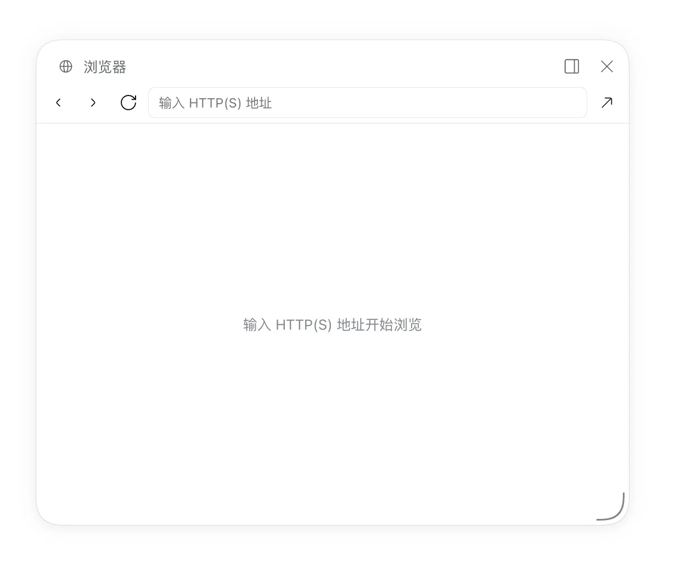

# dsh-plugin-sidebar-tabs

给 DeepSeek Harness 右侧栏补两件事：浏览器式的标签管理（批量关闭、浮出为浮窗、重新打开已关闭的
标签、标签总览页），以及**视频 / 音频的内联播放**。

## 状态

**过渡期项目。** 本插件的目的，是在 DeepSeek Harness 原生提供这些体验之前，把它们补上。
**官方原生提供之后本项目即停止维护**，届时请卸载本插件、改用原生能力。

欢迎 star、fork、PR。

## 安装

DSH 桌面端：**设置 → 插件 → 添加插件**，粘贴：

```
https://github.com/neil-ji/dsh-plugin-sidebar-tabs
```



装完是这个样子，点「立即启用」：



然后刷新一次页面：按 `F12` → Console → `location.reload()`。

命令行（`web` profile；桌面端的 `desktop` profile 由应用独占管理，只能用插件页）：

```bash
dsh plugin --profile web add https://github.com/neil-ji/dsh-plugin-sidebar-tabs
```

## 能力

- **标签右键菜单**：关闭其它 / 关闭左侧 / 关闭右侧 / 关闭全部、浮出为浮窗（浮窗里则是收回）、
  复制标签地址、重新打开已关闭的标签。
- **标签管理页**（引导页入口）：按分栏列出所有已打开标签，点行跳转、逐个 / 整格 / 全部关闭，
  浮窗可收回，并列出"最近关闭"以便恢复。
- **四个键盘命令**：关闭其它、关闭全部、重新打开、打开标签管理。默认键位与其他命令撞车时会自动
  降级为未绑定，可在设置里自己绑。
- **媒体内联预览**：右侧栏里点开视频 / 音频文件时，直接用一个原生播放器内联播放，可拖动进度条。
  覆盖 `mp4` `m4v` `webm` `ogv` `mov` `mkv` `avi` 与 `mp3` `m4a` `aac` `wav` `flac` `ogg`
  `oga` `opus`；其余后缀仍然交给官方预览原有的纯文本 / 其它渲染器。

### 关于媒体预览

官方预览包（`@deepseek-ai/dsh-client-ui-sidebar-documentpreview`）把「按后缀选渲染器」做成了公开
注册表，但自带的完整字节通道有上限——`readAll` 默认 32 MiB，且走 base64，PDF 和截图够用，电影
不够用，也没有 seek。所以本插件的媒体播放不走那条路：

- **Host 半**在 `webServer` 上注册两条路由：`POST /api/sidebar-tabs/media/sign` 为「会话 + 文件」
  签发一个 HMAC 签名、带过期时间的 URL；`GET /api/sidebar-tabs/media/stream?token=…` 按 `Range`
  返回字节，支持 `206` / `416` / `HEAD`，浏览器可以边下边播、任意 seek。
- 文件读取本身交回官方 `workspaceFiles` 服务，按字节窗口分页读取，所以**读权限、沙箱策略、路径
  解析都由 DSH 决定**，本插件不直接开文件；内存占用与文件大小无关。
- 播放器只是一个原生 `<video controls>` / `<audio controls>`，地址是那条签名 URL。

限制：默认流地址有效期 6 小时（`mediaTokenTtlMs` 可调）；`mkv` / `avi` 能否真的播出取决于容器
里的编码，Chromium 认不出来的编码只会报一个播放失败，不会回退成别的东西。

## 效果展示

标签右键菜单：



「浏览器」标签浮出为浮窗：



## 开发

零依赖，不需要打包器。

```bash
npm run build   # src/ -> lib/（Host 半的三个媒体模块在构建时内联进 lib/index.js）
npm run check   # 产物与 src/ 不一致时 exit 1
npm test        # 桩件加载产物并驱动 apply()，另含 token / Range / 路由的往返测试
```

`lib/` 提交进仓库是刻意的：git 安装不跑构建步骤，所以产物必须自包含。CI 跑上面两条命令。

源码分两半：`src/client.js` 是浏览器片段，`src/host/` 是 Host 侧（`client.js` 为插件本体，
`media-token.js` / `media-range.js` / `media-types.js` 是可单测的纯逻辑，构建时内联）。

实现细节、扩展点、以及踩过的坑见 [docs/notes.md](docs/notes.md)。

## License

[MIT](LICENSE)
